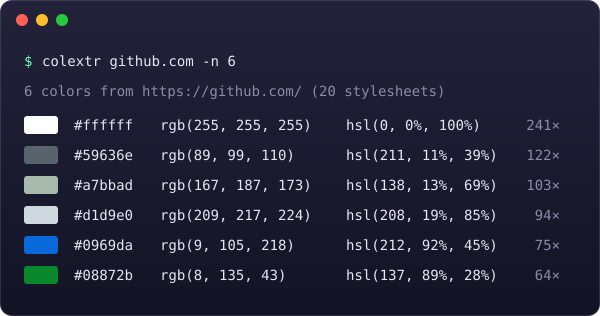

<p align="center">
  
</p>

<h1 align="center">colextr</h1>

<p align="center">
  <strong>Extract the color palette of any website, right from your terminal.</strong>
</p>

<p align="center">
  
  
  
  
</p>

<p align="center">
  
</p>

## Features

|                       |                                                                                          |
| --------------------- | ---------------------------------------------------------------------------------------- |
| **Zero dependencies** | Plain Node.js, about 450 lines you can read in one sitting.                              |
| **Modern CSS**        | Understands hex, `rgb()`, `hsl()`, `oklch()` and `oklab()`, legacy and modern syntax.    |
| **Ranked by usage**   | Colors are sorted by how often the site uses them, so brand colors float to the top.     |
| **Real swatches**     | Every color is drawn as a block of that color in any truecolor terminal.                 |
| **Pipe-friendly**     | Export as hex, rgb, hsl, JSON or CSS custom properties. Piped output stays clean.        |

## Install

Requires [Node.js](https://nodejs.org) 18.3 or newer.

```sh
git clone https://github.com/<your-username>/colextr.git
cd colextr
npm link        # makes the `colextr` command available globally
```

## Usage

```
colextr <url> [options]

  -f, --format <type>   pretty | hex | rgb | hsl | json | css  (default: pretty)
  -n, --limit <number>  Show only the N most used colors
  -t, --timeout <sec>   Network timeout per request  (default: 10)
      --no-color        Don't draw color swatches
  -h, --help            Show this help
  -v, --version         Show the version
```

The `https://` prefix is optional, so `colextr github.com` just works.

### Export formats

| Format   | Example output                                                      |
| -------- | ------------------------------------------------------------------- |
| `pretty` | swatch, hex, rgb, hsl and count in an aligned table (default)       |
| `hex`    | `#0969da`                                                           |
| `rgb`    | `rgb(9, 105, 218)`                                                  |
| `hsl`    | `hsl(212, 92%, 45%)`                                                |
| `json`   | `[{ "hex": "#0969da", "rgb": "…", "hsl": "…", "count": 75 }]`       |
| `css`    | `:root { --color-1: #0969da; }`                                     |

```sh
colextr stripe.com -n 5 -f hex          # quick list
colextr stripe.com -f css > palette.css # drop-in CSS variables
colextr stripe.com -f json | jq '.[0]'  # feed other tools
```

When the output is piped or redirected, swatches are left out automatically and the summary line goes to stderr, so files stay clean. Swatches are also disabled by `--no-color` or the [`NO_COLOR`](https://no-color.org) environment variable.

## How it works

1. **Fetch:** download the page and every stylesheet it links to, following `@import`s.
2. **Collect:** gather CSS written into the page itself: `<style>` blocks, `style=""` attributes, inline SVG `fill`/`stroke` and the `theme-color` meta tag.
3. **Extract:** scan CSS declaration values for colors (selectors and comments are skipped), convert each one to sRGB and count how often each appears.

```
bin/colextr.js    command-line interface
src/fetch.js      downloads the page and its stylesheets
src/html.js       finds stylesheet links and inline CSS in HTML
src/css.js        finds and counts colors in CSS
src/color.js      parses and converts color notations
src/format.js     renders the result as a table, list, JSON or CSS
```

## Limitations

- **CSS added by JavaScript isn't seen.** Some single-page apps and CSS-in-JS libraries inject their styles at runtime. colextr reads what the server sends and doesn't run a browser, which is what keeps it fast and light.
- **Named colors** like `red` or `white`, and colors built at runtime from `var()` or `color-mix()`, are skipped.
- **Swatches need a truecolor terminal.** iTerm2, the macOS Terminal app, Windows Terminal, VS Code, kitty, WezTerm and most modern terminals support it.

## Development

```sh
npm test   # runs the suite with Node's built-in test runner
```

## License

[MIT](LICENSE)
